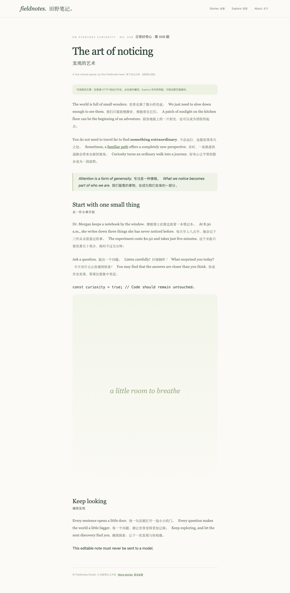

# 句流 · Sentence Flow

一句原文，一句译文。一个使用你自己的模型服务、按句穿插译文的 Chrome 扩展。

- 支持 Ollama 原生接口和 OpenAI 兼容的 Chat Completions 接口。
- 保留原文、链接、加粗和页面交互，点击工具栏图标即可翻译或恢复原文。
- 随滚动处理动态内容，跨刷新复用同一网站的成功译文缓存。
- 服务失败时说明原因，提供查看配置、重试和可导出的本机诊断日志。
- 原生 JavaScript / HTML / CSS，无需构建、无扩展运行时第三方依赖。



目前通过「加载已解压的扩展程序」安装，尚未发布到 Chrome Web Store。产品名称为「句流 · Sentence Flow」；GitHub 仓库可使用 `sentence-flow-chrome`，本地文件夹不需要改名。

## 快速开始

1. 下载或克隆源码；或者解压项目发布的 ZIP。
2. Chrome 打开 `chrome://extensions`，开启「开发者模式」。
3. 点击「加载已解压的扩展程序」，选择含有 `manifest.json` 的项目根目录或 `dist/sentence-flow`。
4. 右键句流图标 →「选项」，填写模型配置，先「测试连接」再「保存设置」。
5. 打开普通 HTTP(S) 网页，点击句流图标开始翻译，再点一次停止并恢复原文。快捷键为 **Alt+T**，macOS 为 **Option+T**。

更新后在扩展管理页重新加载句流，并刷新已经打开的网页。修改配置后，关闭并重新开启翻译；失败页面也可直接点击「重试翻译」。

## 选择正确的模型接口

「在线大模型」表示使用 OpenAI 兼容协议，也可连接本机服务。

| 服务 | 选项页类型 | 服务地址示例 | 模型名称 |
| --- | --- | --- | --- |
| Ollama 原生服务 | 本地 Ollama | `http://127.0.0.1:11434` | `ollama list` 中的完整名称 |
| 本地 OpenAI 兼容桥接 | 在线大模型 | `http://127.0.0.1:11435/v1` | 例如 `qwen3.6:35b-mlx`，以服务实际支持为准 |
| 在线或自托管兼容服务 | 在线大模型 | 服务商提供的 Base URL，例如 `https://api.example.com/v1` | 服务商的完整模型 ID |

原生 Ollama 使用 `/api/chat`，兼容服务使用 `/chat/completions`，也接受完整接口地址。没有鉴权的本地服务可留空 API Key。桥接服务和 Ollama 是两个进程，只启动 Ollama 不代表 `11435` 已启动。

兼容接口须返回 `choices[0].message.content`。模型须支持按提示返回完整 JSON 译文。在线模型返回非 JSON 文本时会以 JSON 约束补试一次；结果的编号、数量和格式仍须完整匹配。暂不支持 Anthropic / Gemini 原生接口或独立 Azure 部署协议。

### Ollama 连接与超时

首次加载本地模型可能较慢，可将超时提高到 180 秒。遇到 HTTP 403 时，在设置页展开「Ollama 连接遇到 403？」查看包含当前扩展 ID 的命令。macOS 先退出 Ollama，再运行：

```sh
launchctl setenv OLLAMA_ORIGINS "chrome-extension://你的扩展ID"
```

随后重新打开 Ollama。Linux / Windows 请在运行 Ollama 的服务中配置相同环境变量并重启。局域网访问还需要服务端监听对应地址。

## 阅读与缓存

使用浏览器的 `Intl.Segmenter` 按句划分文本，再用 DOM Range 将纯文本译文插入句末，保留原有节点和事件。标题、控件、独立链接和布局单元分别处理；倒计时、纯数字、代码和可编辑区域会跳过。

默认优先翻译视口附近内容，滚动、展开和动态加载时继续。「正文与列表优先」覆盖正文和内容面板，略过静态侧栏；「整个页面」也包含侧栏。导航和菜单由独立开关控制。

| 角标 | 含义 |
| --- | --- |
| `…` | 正在翻译，或等待滚动继续 |
| `✓` | 已收集的句子全部完成 |
| `·` | 已开启，暂时没有待译文字 |
| `!` | 发生错误；悬停查看原因，网页内可查看配置或重试 |

缓存按网站 origin、目标语言、服务、模型和内容类型隔离。正文保留 30 天，导航等固定文案保留 180 天；最多 4,000 条、约 12 MiB。同站相同文案复用成功缓存，相同并发请求合并。失败结果不缓存。设置页可查看统计和清空缓存。

同一时间最多两个模型请求，每批最多 12 句 / 6,000 字符。停止翻译会取消当前页面不再需要的请求；其他标签页仍需要的共享请求继续执行。不同子域名、协议或端口不共享缓存。

## 故障排查与日志

- **点击后出现 `!`**：悬停图标或查看网页右下角的错误提示，按说明检查配置后重试。
- **无法连接本地 `11435`**：确认 OpenAI 兼容桥接也已启动，检查 `http://127.0.0.1:11435/health`；服务类型应选择「在线大模型」。
- **服务管理命令误报已运行**：可能是过期 PID 被系统复用。本项目附带可选的桥接修复补丁，见下文。
- **暂时没有译文**：检查目标语言、翻译范围和导航开关；中文为主的内容在中文目标下默认跳过。
- **网页脚本版本过旧**：重新加载扩展后刷新网页。
- **快捷键无效**：在 `chrome://extensions/shortcuts` 检查冲突或修改快捷键。

选项页 →「诊断日志」可查看、导出或清空最近 300 条记录。记录保存在浏览器本机，**不会自动写入 `~/.ljwsoftware`**，不记录网页原文、译文、请求体或 API Key；地址仅保留 origin。重现问题后点击「刷新日志」。

`toolbar.click` 说明点击已到达后台；`page.ready` 可核对脚本版本；`model.network.error` 表示未连上服务；`model.response` 记录 HTTP 状态；`translation.error` / `operation.error` 记录失败原因。如果后台未能启动，在 `chrome://extensions` 查看句流的「错误」或 service worker 控制台。

使用可选 `ollama-service translate` 桥接时，运行 `ollama-service translate logs` 查看服务日志；日志位于该桥接项目的 `.translate-service/server.log`。

## 隐私与权限

扩展需要 HTTP(S) 网站访问权限，以加载内容脚本并连接你配置的模型服务。仅在主动开启翻译后扫描网页文本；API 请求在扩展后台执行，网页与内容脚本不能读取配置密钥。

API Key、缓存和诊断日志保存在浏览器本机。在线服务会接收你提交的待译文字；本地模型服务在其配置地址处理文字。项目不包含遥测、广告、账号同步或独立云端后端。完整说明见 [PRIVACY.md](PRIVACY.md)。

## 已知边界

- 需要 Chrome 116 或更新版本；其他 Chromium 浏览器未经完整验证。
- 暂不支持浏览器内置页、Chrome 商店、PDF、图片文字、iframe、Shadow DOM 和文件 URL。
- 隐藏内容、代码、输入与编辑区域、`translate=no` 区域会跳过；少数强控制 DOM 的页面可能需要恢复原文并刷新。
- 分句依赖语言规则及常见缩写修正，复杂缩写仍可能分错。单句超过 1,800 字符时分块；单个异常超长段落有收集上限。
- 译文质量、响应速度、使用额度和费用取决于模型及服务。

## 开发与验证

扩展本身无需安装依赖或执行构建。单元测试需要 Node.js 20.11+，打包需要 Python 3。

```sh
npm test
python3 tools/package.py
```

打包结果是 `dist/sentence-flow/` 和对应版本 ZIP。浏览器集成测试需要 Playwright 与可用 Chromium：

```sh
npm install --no-save playwright
npx playwright install chromium
npm run test:e2e

# 可选：使用已安装、支持加载扩展的测试浏览器
CHROME_EXECUTABLE="/path/to/chrome-for-testing" npm run test:e2e
```

也可用 `PLAYWRIGHT_MODULE` 指定已安装 Playwright 的模块路径。测试使用临时浏览器配置和本机模拟模型服务，不调用真实模型或真实 API Key；覆盖翻译、缓存、动态内容、取消、工具栏、错误恢复、设置与日志。截图生成于忽略提交的 `artifacts/`。

手动验收：运行 `python3 -m http.server 8765 --bind 127.0.0.1`，打开 `http://127.0.0.1:8765/demo/article.html`。

### 可选桥接修复

`tools/` 内的补丁用于独立的 `ollama-openai-bridge` 项目，不是扩展运行依赖，也不会自动修改外部项目或重启服务。

- `ollama-server-cancellation.patch`：将 HTTP 断开传给上游，包括非流式请求。
- `ollama-service-pid.patch`：核对 Node 进程及精确脚本路径，避免过期 PID 误判；停止失败时阻止继续启动。

```sh
# 在临时副本验证补丁；目标源码已修复时追加 --verify
node tests/bridge-cancellation.mjs /path/to/ollama-server
node tests/service-manager-pid.mjs /path/to/ollama-server
```

## 项目结构

```text
background/       请求、并发、缓存、诊断日志与工具栏状态
content/          文本抽取、译文插入与动态页面处理
shared/           分句、配置校验与通用样式
options/          设置、诊断、版权与隐私页面
demo/             手动和自动验收页面
tests/            单元测试与浏览器集成测试
tools/            打包工具及可选桥接补丁
docs/images/      README 展示图片
```

## 开源许可与参考资料

本项目采用 [MIT License](LICENSE)，版权声明为 `Copyright (c) 2026 Sentence Flow contributors`。设置页底部可打开「关于 · 版权与许可」，查看完整许可及隐私说明。

技术参考资料与实现对应关系见 [REFERENCES.md](REFERENCES.md)，依赖和素材说明见 [THIRD_PARTY_NOTICES.md](THIRD_PARTY_NOTICES.md)。参考链接用于说明接口和标准来源；本项目不宣称附带学术论文或第三方认证。历史变化见 [CHANGELOG.md](CHANGELOG.md)。
